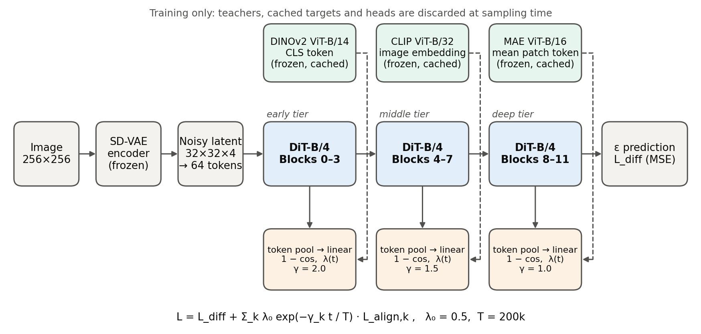

# LARA-DiT

**Layer-Adaptive Representation Alignment with Depth-Stratified Multi-Teacher Supervision for Diffusion Transformer Training**

Undergraduate research project, Department of Computer Science and Engineering, Thapar Institute of Engineering and Technology. *Manuscript in preparation.*

LARA-DiT asks whether **different depths of a diffusion transformer should be supervised by different pretrained teachers**. A 12-block DiT-B/4 is split into three tiers. Each tier's last block is aligned to a different frozen encoder (DINOv2 → blocks 0–3, CLIP → blocks 4–7, MAE → blocks 8–11) through its own projection head, and each alignment weight decays independently: λₖ(s) = λ₀·exp(−γₖ s/S).



## Status — read this first

The results below come from **one training run per configuration** on ImageNet-100. They were evaluated with a sampler whose random noise was not seeded or matched across models; that bug is now fixed (see [Reproducibility notes](#reproducibility-notes)). Treat them as **preliminary**. **LARA-DiT does not beat the baseline overall**: the baseline has the best FID, LARA-DiT the best Inception Score.

| Configuration (200K steps) | FID ↓ | IS ↑ | Alignment |
|---|---|---|---|
| Baseline | **44.66** | 25.81 ± 0.71 | none |
| REPA-style (global) | 48.86 | 25.87 ± 0.95 | DINOv2 on the early tier, constant λ = 0.5 |
| LARA-DiT | 45.66 | **27.37 ± 0.89** | DINOv2 / CLIP / MAE, decaying λ |
| All-DINOv2 ablation | 86.18 | 15.42 ± 0.37 | DINOv2 on all three tiers, decaying λ |

How these numbers were measured:
- 10,000 class-balanced samples per model, 1,000-step DDPM sampling, guidance scale 1.5. These are the configured settings; they weren't recorded per run.
- FID uses clean-fid against the 5,000 ImageNet-100 validation images, so it is **not comparable with published ImageNet-1K numbers**.
- IS uses torchvision's Inception-v3 with 10 splits; the ± is the spread across splits.

Raw outputs are in [`results/original_runs/`](results/original_runs) and training curves in [`results/figures/`](results/figures).

Alignment added about **0.4% training time**: all four runs took 56.9–57.1 s per 100 steps, about 31.7 h each on an H100 MIG 3g.40gb slice.

## Repository layout

```
src/              model (DiT-B/4), teachers + projection heads, losses, diffusion, trainer, metrics
scripts/          00–12: environment checks, data setup, feature/latent caching, training, evaluation, benchmarks
tests/            CPU unit tests (pytest)
configs/          experiment configuration
analysis/         scripts that regenerate every figure/table in results/figures from results/original_runs
results/          metrics, configs, TensorBoard logs and checkpoint SHA-256s of the original runs
RUNBOOK.md        step-by-step plan for the follow-up GPU experiments
run_revamp.sh     phase runner for that plan;   run_final_experiments.sh: the original four runs
```

## Setup

Python ≥ 3.10 with a CUDA build of PyTorch ≥ 2.4. Install PyTorch for your CUDA version first, then the rest:

```bash
pip install -r requirements.txt
python -m pytest tests -q          # CPU only; should report all tests passing
```

ImageNet-100 goes in `<root>/{train,val}/<class>/*.JPEG`. [`scripts/01_setup_imagenet100.py`](scripts/01_setup_imagenet100.py) downloads it from Kaggle; you need your own credentials at `~/.kaggle/kaggle.json`.

## Reproducing the original four runs

```bash
python scripts/03_precompute_features.py --teacher dinov2      # also: clip, mae  (pooled, L2-normalised targets)
bash run_final_experiments.sh                                  # baseline, repa, lara_dit, ablation; 200K steps each
```

To regenerate the figures and the training summary from the included logs:

```bash
python analysis/parse_events.py && python analysis/plot_training.py && python analysis/paper_figures.py
```

## Follow-up experiments (prepared, not yet run)

The code also supports the experiments needed to turn these preliminary results into solid claims. Each is unit-tested on CPU but **has not been run on a GPU yet**:

| Option | What it does |
|---|---|
| `--align patch` | REPA-faithful alignment: all 64 tokens vs. teacher patch tokens on an 8×8 grid, 3-layer MLP projector |
| `--mode custom --teachers mae,clip,dinov2 --gammas 2,1.5,1` | any teacher at any depth (`-` leaves a tier unaligned) |
| `--use-latents` | train from cached VAE posteriors instead of encoding images every step |
| `--diag-every 1000` | per-tier gradient norm and cosine with the denoising gradient |
| `scripts/07_evaluate.py` | seeded, matched sampling; 250 respaced steps; FID vs. a 50k train reference and val; precision/recall; full manifest |

See [RUNBOOK.md](RUNBOOK.md) for the order, budget gates and what each outcome would mean.

## Reproducibility notes

- **Sampling RNG.** The original evaluation seeded a generator but never passed it to the sampler, so noise was neither controlled nor recorded. The sampler now takes the generator for every random draw; `tests/test_core.py::test_sampler_rng_controlled` covers this.
- **Paired augmentation.** Teacher features are precomputed. Each image therefore always gets the same crop and flip (seed 42 + index), so student inputs match cached targets. Caches store their image order and seed, and loading fails if either doesn't match.
- **Checkpoints** are not included (about 2 GB each); their SHA-256 hashes are in [`results/original_runs/checkpoint_sha256.txt`](results/original_runs/checkpoint_sha256.txt).

## Related work

LARA-DiT builds on [REPA](https://arxiv.org/abs/2410.06940) (Yu et al., ICLR 2025) and is closely related to [HASTE](https://arxiv.org/abs/2505.16792), [iREPA](https://arxiv.org/abs/2512.10794) and multi-teacher distillation such as [AM-RADIO](https://arxiv.org/abs/2312.06709). The model follows [DiT](https://arxiv.org/abs/2212.09748) (Peebles & Xie, ICCV 2023).

## Citation

```bibtex
@misc{kashyap2026laradit,
  title  = {LARA-DiT: Layer-Adaptive Representation Alignment with Depth-Stratified Multi-Teacher Supervision for Diffusion Transformer Training},
  author = {Kashyap, Atishay},
  year   = {2026},
  note   = {Manuscript in preparation. Code: https://github.com/AtishayKashyap/LARA-DiT}
}
```

## License

MIT — see [LICENSE](LICENSE). Pretrained teachers (DINOv2, CLIP, MAE), the SD-VAE and ImageNet are under their own licences and terms.
